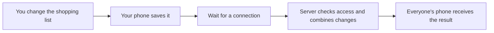

# How the app fits together

Updated 2026-11-28. This explains the design we have agreed to work towards. It does not mean the app has been built.

## The basic idea

**Your phone saves shopping changes immediately, even without internet. When it reconnects, it shares those changes with the household.**

A shared server checks who is allowed to make each change and applies the agreed rules when people have edited the same item. Each phone then receives the confirmed result.

For example, Alice buys one carton of milk while Bob buys two offline. When both phones reconnect, the list shows three cartons bought. Sending Alice's saved change twice must still count her purchase only once.

## What each part does

| Part | In everyday terms | Planned technology |
| --- | --- | --- |
| Phone app | Shows lists, accepts changes and keeps working offline | React Native and Expo, using TypeScript |
| Phone storage | Keeps the saved list and changes waiting to be sent, including after a restart | SQLite |
| Shared server | Checks household access and applies the shared rules | One Go application, divided into clear areas of responsibility |
| Shared database | Holds confirmed household records and the information needed to catch phones up | PostgreSQL |
| Sign-in service | Checks the person's email code or password | An established hosted provider; still to be selected |
| Notifications | Tell people about relevant changes and unresolved choices | In-app notices; push delivery service still to be confirmed |

There is one server application to operate initially. Its internal areas cover accounts, households, products, shopping lists, synchronization and notifications.

## Three things that must stay separate

| Thing | Example | Why it is separate |
| --- | --- | --- |
| Saved product | Milk, normally measured in litres | Reuse it next time without creating another product |
| Current shopping need | Buy 2 litres of milk on today's list | This is what the household currently wants |
| Actual purchase | Alice bought 1 litre today | Keep the amount and who bought it, even if the requested amount changes |

Yesterday's milk purchase must not fulfill a new request made today. Correcting a purchase changes the buying record; it does not rewrite how much the household asked for.

Households own their lists, saved products and custom units. A person may belong to more than one household, but one household cannot see another's data.

## What happens when you tap Purchased

1. The app normally fills in the amount still needed on that phone. You can enter a different amount.
2. The phone saves both the purchase and the reminder to send it. Either both are saved or neither is, so a crash cannot leave half the job done.
3. On reconnection, the server checks the signed-in person and their current household membership.
4. It records the purchase once, applies any conflict rules and saves the updates other phones need.
5. The other phones catch up. Any changes still waiting on your phone are preserved.

The app distinguishes **saved on this phone** from **confirmed as shared**. A push notification is only an alert; missing it must not stop the list from catching up.

## When people disagree

Most cases use the rules already approved. For example, two separate purchases add together. Conflicting requested amounts use the household's larger/smaller/ask setting.

Some cases need a person to choose. The app preserves the competing information and shows what needs attention. It must not silently lose a purchase or use an old purchase to satisfy a new need.

See [how offline changes are combined](sync-data-design.md) for examples.

## Privacy and access

- Signing in identifies a person. The server separately checks which households that person belongs to.
- Saved data for different accounts stays separate on a phone.
- Signing out hides account data. Pending work is kept privately for that same account.
- A phone without internet cannot instantly learn that a member was removed. On reconnection, it must reject that member's old changes and hide the household.
- A deleted account cannot regain its old data merely by signing up again with the same email.
- Protecting phone storage and deleting data from backups still need technical checks before release.

## Where it will run

The current plan is to host the server and shared database on DigitalOcean. We must inspect the actual hosting setup before changing anything there.

For the builder: the existing baseline uses Docker Compose to manage the services and Caddy for secure HTTPS connections. It does not require separate microservices, Kafka, Redis or Kubernetes.

Before release, we need working backups and recovery, secure connections, safe handling of credentials, and checks that the service is healthy. Deployment remains a separate step.

## What is ready and what remains

**Ready as design:** the main parts, the shopping rules and the overall approach to offline changes.

**Still to finish:** [sign-in provider selection (#5)](https://github.com/Bazuzu77/shopping-list/issues/5), [exact messages and worked sync examples (#8)](https://github.com/Bazuzu77/shopping-list/issues/8), database layouts and release arrangements.

Future nearby sharing may carry the same saved changes directly between phones. It must still respect which decisions require server confirmation. Store integrations, store recommendations and the household timetable belong to later work.

[All design documents](README.md) · [Architecture epic](https://github.com/Bazuzu77/shopping-list/issues/33)
