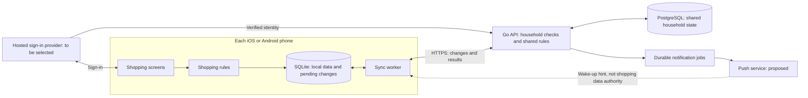
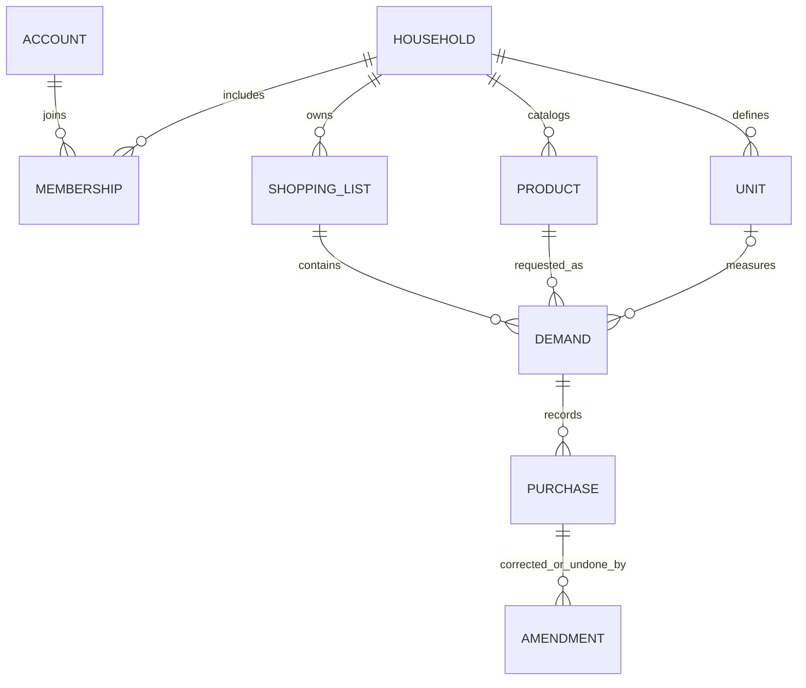

# System overview

Updated: 2026-11-28. This document summarizes the existing approved direction and selected planning baseline. It adds no new product behavior, vendor selection or deployment approval. No application implementation is claimed.

## Basic design

The phone handles everyday shopping immediately, including without internet. It saves each change locally and keeps it queued until the server accepts it. The server checks household access, applies shared conflict rules and sends authoritative updates back to each phone.

## Main parts and responsibilities

| Part | Responsibility |
| --- | --- |
| Expo / React Native / TypeScript app | Shopping screens, quantity validation, optimistic local state and account-specific preferences |
| SQLite storage | Save local state and a pending operation together in one transaction; retain work across restarts |
| Sync worker | Retry safely, upload pending operations, download updates and recover from an old checkpoint |
| Go modular monolith | One deployable service with identity, households, catalog, lists, sync and notification modules |
| PostgreSQL | Shared records, accepted operation results, conflict choices, change feed and durable notification jobs |
| Hosted identity service | Verify email/password/code identity; exact provider remains issue #5 |
| Push service | Notify or prompt catch-up; in-app state and sync must work without push |

Versioned contracts and common examples will keep TypeScript and Go behavior aligned. Neither the phone's clock nor arrival order is a universal conflict rule. Some approved outcomes deliberately use server acceptance order; see the detailed sync design.

## Logical data model

- **Product:** a reusable household catalog entry, such as milk.
- **Demand:** milk needed on a particular list for a particular shopping cycle, with requested amount, unit, buyer and notes.
- **Purchase:** one actual buying action with its own identity and historical descriptions. Separate purchases add together; retrying the same purchase does not.
- **Amendment:** a correction or undo referencing that purchase. Undo does not rewrite the requested amount.

This separation prevents yesterday's purchase from fulfilling today's new milk request. Units are optional; whole-number and decimal behavior follows the approved product rules. The diagram is a logical overview, not the complete database schema: operations, aliases, conflict candidates, sessions, invitations and notification records are detailed in [sync-data-design.md](sync-data-design.md).

## One change from tap to shared state

1. The app validates the action and saves both its pending operation and visible local result atomically.
2. When connected, it sends the operation with a stable ID and the relevant observed/dependent changes.
3. The API verifies the account, current household membership and operation validity. Repeated operations have one effect.
4. In a household transaction, the server applies the approved rules and saves the result, change-feed entry and any notices together.
5. Each phone applies downloaded changes and its checkpoint atomically, then reapplies still-pending local work over that confirmed state.

Most conflicts resolve automatically under the approved rules. Cases needing human judgment remain visible as choices. Permanent deletion must defeat delayed offline changes. The exact message schemas and complete worked examples are still tracked in issue #8.

## Security boundaries

- The identity provider proves who signed in; the Go API decides which household records that account may access. Email addresses are not stable account IDs.
- Check live session and membership grants on protected API actions. A removed member's old operation queue cannot gain access merely by rejoining later.
- Every shared record and reference is household-scoped. Account notifications and credentials are private, outside the shared household feed.
- Keep local account stores isolated and credentials in OS-backed storage. Encrypted local storage is the proposed approach and still needs native-build validation.
- Offline expiry permits previously authorized local work; explicit logout, confirmed removal and revocation follow the approved hiding/rejection rules. An offline device learns remote revocation on reconnect.
- Deletion includes access revocation and controlled removal of data. Backup retention and deletion replay need operational validation before production claims.

## Hosting and operation

Planning baseline: Go service and PostgreSQL on DigitalOcean, Docker Compose for service management, and Caddy for HTTPS. Inspect actual infrastructure before choosing capacity or changing existing workloads. PostgreSQL-backed jobs avoid an additional queue service initially. No Kafka, Redis, Kubernetes or microservices are required by this baseline.

Schema migrations, backups, restore checks, logs, health checks and secrets management must be planned before release. Real SQLite and PostgreSQL tests are required for durability and concurrency; diagrams are not test evidence.

## Why this structure

Local storage makes the shopping flow usable without connectivity. An explicit operation protocol captures the approved purchase, undo and conflict semantics. One modular server keeps deployment manageable while separating responsibilities in code. Alternatives and their trade-offs are recorded in the [sync design](sync-data-design.md#1-recommendation-and-alternatives).

Future device-to-device sync may carry the same operations over a nearby connection, but cannot independently finalize server-ordered choices. Supermarket connections and the later household timetable are future epics, not dependencies of the first release.

## What is still unfinished

Provider selection (#5), exact sync contracts and examples (#8), concrete migrations/API schemas in the relevant implementation plans, and validated production infrastructure. Catalog-default and late-arriving-conflict proposals must be checked against approved behavior. No new approval is implied by this overview.
