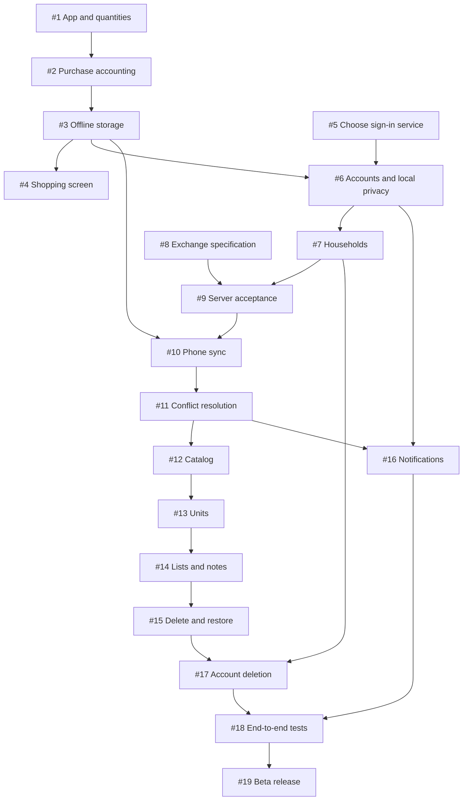

# Work dependencies

Verified against native GitHub issue relationships on 2026-11-28. An arrow means the earlier task must finish before the later task. Epic grouping and tentative future order are separate from these blockers.

Issue #8 has an uploaded approved design but still needs exact exchange formats and worked examples. It can progress without waiting for #2; their models must remain consistent. Future epics have no invented blockers or dates. Shared household timetable remains the farthest future item.

[Open the ordered project plan](https://github.com/users/Bazuzu77/projects/1/views/2) · [Backlog](README.md)

